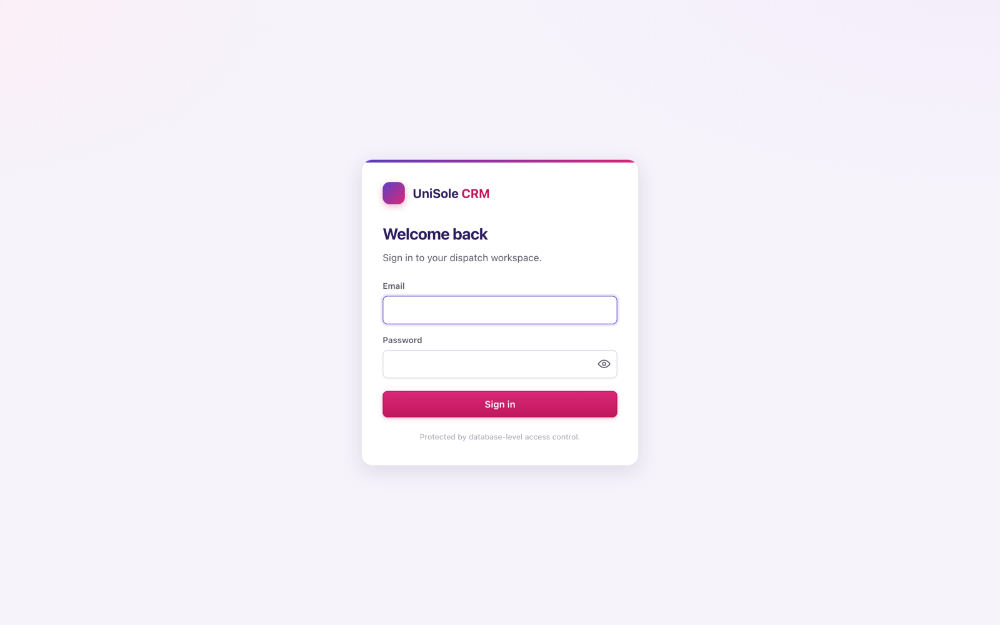
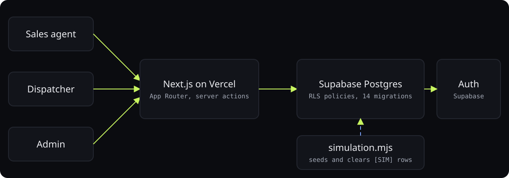
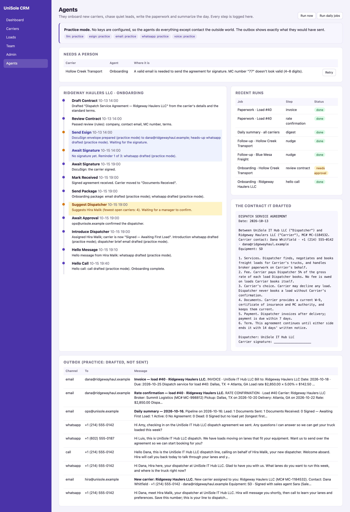

<div align="center">



# Freightly

**Dispatch CRM for a truck-dispatching company: sales pipeline, carriers, loads, and team targets in one place.**

<p>
<a href="https://unisole-crm.vercel.app"></a>
<a href="https://ibiraheel.com/p/freightly"></a>
</p>

<p>


</p>

</div>

<br>

> **Spreadsheets to a live CRM**  
> for UniSole IT Hub, a truck-dispatch business with sales agents and dispatchers

## What it did

Working MVP with auth, carriers, loads, dashboards, team targets, and row-level security, running on Supabase and deployed on Vercel.

<sub>Outcome: reported by the owner.</sub>

## How it works

<p align="center"></p>

1. Next.js App Router with server actions; no separate API service to run.
2. Supabase Postgres with row-level security so agents and dispatchers only see their own book.
3. Fourteen ordered SQL migrations plus a simulation script that seeds and clears [SIM] demo rows.
4. Product defined first: PRD, design doc, and roadmap live in the repo and drove the build.

## Run it locally

```bash
cp .env.local.example .env.local   # Supabase URL + anon key (+ service role for admin logins)
# apply the schema: paste supabase/apply_all.sql into the Supabase SQL editor
npm install
npm run dev                          # http://localhost:3000
```

## Repository layout

```
├── app/
│   ├── (app)/
│   ├── api/
│   ├── login/
│   ├── globals.css
│   ├── layout.tsx
│   └── page.tsx
├── components/
│   ├── AgentAssigner.tsx
│   ├── CarrierFilters.tsx
│   ├── CarrierForm.tsx
│   ├── DispatcherAssigner.tsx
│   ├── DispatchNoteModal.tsx
│   ├── EditCarrierForm.tsx
│   ├── FollowUpModal.tsx
│   ├── icons.tsx
│   ├── LeadImportForm.tsx
│   ├── LifecycleStrip.tsx
│   ├── LoadAmountEditor.tsx
│   ├── LoadFilters.tsx
│   ├── LoadForm.tsx
│   └── LoadsFlowMap.tsx
│   └── … 14 more
├── lib/
│   ├── actions/
│   ├── supabase/
│   ├── auth.ts
│   ├── presence.ts
│   ├── status.ts
│   └── usStates.ts
├── supabase/
│   ├── migrations/
│   ├── apply_all.sql
│   ├── README.md
│   └── seed.sql
├── CLAUDE.md
├── middleware.ts
├── next.config.mjs
├── package.json
├── ROADMAP.md
├── simulation.mjs
├── tsconfig.json
├── UniSole_CRM_Design.md
├── UniSole_CRM_PRD.md
└── vercel.json
```

---

<div align="center">

<sub>Built by <a href="https://github.com/ibi-raheel">Muhammad Ibrahim Raheel</a> · more work at <a href="https://ibiraheel.com">ibiraheel.com</a></sub>

</div>

## AI agents



Four agents work inside the CRM. They start themselves from database triggers, so no form, import or SQL edit can skip them, and every step they take is logged in `agent_steps`.

| Agent | Starts when | What it does |
|---|---|---|
| **Onboarding** | a carrier moves to *Documents Sent* | Drafts a custom contract from the carrier's details and the fixed terms. Reviews it (rules, plus an AI second opinion) and holds it for a person if anything is wrong. Sends it by DocuSign and reminds the carrier every 2 days, up to 3 times. On signature it marks *Documents Received*, sends the onboarding package and suggests the least-busy dispatcher. Once **a manager confirms**, it assigns them (the database moves the carrier to *Signed — Awaiting First Load*), introduces them, and sends the hello message and the hello call. |
| **Follow-up** | daily | Nudges carriers in *Lead* / *Documents Sent* who have been quiet for 3+ days. |
| **Paperwork** | a load is booked / delivered | Drafts the rate confirmation, then the invoice. |
| **Daily summary** | daily | Sends admins the pipeline plus who is *Signed but no load yet*. |

Plus **Who to call next** on `/agents`: an explainable score per open lead, with the reason written out.

```
carrier → "Documents Sent" ──trigger──▶ agent_runs (queued)
                                             │  /api/agents/tick (cron) or right after the edit
                                             ▼
draft_contract → review_contract ─(issue)─▶ needs a person
      → send_esign → waiting ─(DocuSign webhook)─▶ mark_received → send_package
      → suggest_dispatcher → manager confirms on /agents → introduce_dispatcher
      → hello_message → hello_call → done
```

**Practice mode (no keys).** Every outside service (Claude, DocuSign, email, WhatsApp, Twilio calls) switches on only when its key is set. Without keys the agents do everything except contact the outside world, and `/agents` shows exactly what they would have sent. *Simulate signature* stands in for DocuSign.

**See it without a database:** `npm run agents:demo` runs the real engine on an in-memory copy of the CRM and writes `docs/agents/demo-report.html`.

**Switch it on:**
1. Run `supabase/migrations/20261013120000_agents.sql`. It adds four tables and two triggers and changes nothing existing.
2. Set `CRON_SECRET`. `vercel.json` runs `/api/agents/tick?daily=1` daily (Hobby plan); on Pro, add a `*/10 * * * *` tick.
3. Add keys as you're ready: `ANTHROPIC_API_KEY` (+ `AGENT_MODEL`), `DOCUSIGN_ACCESS_TOKEN` + `DOCUSIGN_ACCOUNT_ID` (+ `DOCUSIGN_CONNECT_SECRET` for the webhook at `/api/agents/esign`), `RESEND_API_KEY` + `AGENT_FROM_EMAIL`, `WHATSAPP_TOKEN` + `WHATSAPP_PHONE_ID`, `TWILIO_ACCOUNT_SID` + `TWILIO_AUTH_TOKEN` + `TWILIO_FROM`.
4. Confirm the contract terms in `lib/agents/templates.ts` (`TERMS`) with the business. The legal text is a fixed template; the AI only writes cover notes and reviews.

Code: `lib/agents/` (engine, providers, templates, Supabase and in-memory stores), `app/(app)/agents/`, `app/api/agents/`.
